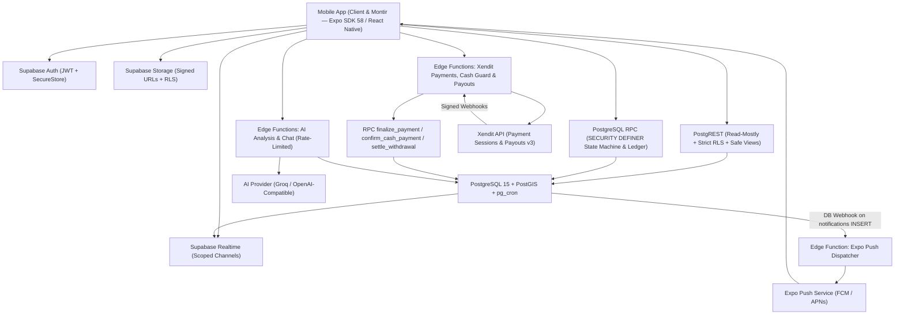

# Arsitektur Sistem MontirGo

Dokumen ini menjelaskan arsitektur backend, mobile client, dan batas keamanan (*trust boundaries*) **MontirGo** yang dibangun dengan pendekatan **100% Supabase-native**.

---

## 1. Diagram Sistem

---

## 2. Tanggung Jawab per Lapisan

| Lapisan | Teknologi | Tanggung Jawab & Batasan |
| --- | --- | --- |
| **Mobile App** | Expo Router, React Native, TypeScript | UI Client & Montir, GPS foreground/background (`expo-location` + `expo-task-manager`), penyimpanan sesi terenkripsi (`expo-secure-store`), pemanggilan RPC & Edge Functions, serta plugin native terdaftar (`expo-location`, `expo-secure-store`, `expo-image`, `expo-web-browser`) dengan aset suara alert ramah AAPT2 (`montirgo_alert.mp3` / `montirgo_alert_ios.aiff`). Tidak pernah memegang secret API key atau menentukan harga/role/status bayar. |
| **Auth & Session** | Supabase Auth | Autentikasi email/password + JWT. Role diambil dari `public.profiles.role`, bukan dari metadata client. |
| **Data Read Layer** | PostgREST + RLS + Views | Pembacaan data milik sendiri atau data agregat aman lewat view (`mechanic_directory`, `mechanic_open_request_view`, `mechanic_assignment_profile`, `mechanic_review_view`, `admin_*`). |
| **Command / State Layer** | PostgreSQL `SECURITY DEFINER` RPC | Seluruh mutasi sensitif (*write-through-commands*): membuat order, ajukan/konfirmasi montir, transisi status perjalanan, pembatalan, finalisasi/revisi tagihan, pencairan, dan pelepasan saldo matang. |
| **Geospatial & Scheduler** | PostGIS + `pg_cron` | Matching radius (`ST_DWithin`), penghitungan jarak (`ST_Distance`), auto-expire pengajuan (5 menit), auto-expire request terbuka (30 menit), pelepasan saldo matang (15 menit), dan retensi data operasional (harian). |
| **Edge Functions** | Deno (Supabase Edge Runtime) | Integrasi pihak ketiga ber-secret: Xendit Payment Sessions, Xendit Payouts v3, konfirmasi cash dengan pengecekan anti-double-charge Xendit, webhook handler, AI diagnosis & chat (dengan rate limit, konteks jenis kendaraan `Sepeda motor`/`Mobil` dari Garasi, dan patokan harga bengkel Indonesia), serta push notification dispatcher. |
| **Realtime** | Supabase Realtime | Push perubahan row terfilter (`id=eq.<id>`, `user_id=eq.<id>`, `client_id=eq.<id>`, `mechanic_id=eq.<id>`) dengan `subscribeWithResync` (`INSERT`, `UPDATE`, `DELETE` pada `MechanicAlertsProvider`) untuk sinkronisasi instan antar layar. |
| **Object Storage** | Supabase Storage | Bucket publik (`avatars`) dan privat dengan signed URL (`vehicle-photos`, `workshop-photos`, `complaint-photos`). |

---

## 3. Prinsip Batas Kepercayaan (*Trust Boundaries*)

1. **Zero Client Trust untuk Data Sensitif**:
   - `role`, `is_verified`, `rating_avg`, `total_jobs`, `is_available`, `price_amount`, `status`, `payment_status`, dan `mechanic_wallets.*` hanya dapat diubah oleh trigger, RPC `SECURITY DEFINER`, `service_role`, atau `admin`.
   - Direct `UPDATE` dari client SDK pada `service_requests` ditutup total.
2. **Privasi PII (UU PDP)**:
   - NIK 16 digit (`identity_number`) disimpan **eksklusif** di `public.profile_identities` dan tidak pernah diduplikasi ke `profiles` maupun `mechanic_profiles`. Hanya pemilik akun dan `admin` yang dapat membacanya.
   - `mechanic_profiles` hanya dapat dibaca pemilik dan `admin`; client membaca profil publik montir melalui `mechanic_directory` atau RPC `list_nearby_mechanics` (tanpa koordinat GPS presisi atau NIK).
   - Sebelum client menyetujui montir (`status = 'mechanic_accepted'`), montir hanya melihat area umum (`address_area`), perkiraan jarak (`distance_km`), keluhan, kendaraan (tanpa plat nomor), foto kendaraan, dan analisis AI — **tanpa `contact_phone` dan tanpa `lat/lng` presisi**.
3. **Resiliensi & Efisiensi**:
   - Semua panggilan `fetch` Supabase di mobile memakai timeout eksplisit (`src/lib/supabase.ts`).
   - Channel Realtime memakai `subscribeWithResync` untuk menyinkronkan ulang data setelah koneksi sempat putus.
   - Rute perjalanan (`route_polyline`, `route_distance_m`, `route_duration_s`) dapat disimpan montir melalui `record_mechanic_location` agar perangkat client tidak memanggil Google Routes API secara ganda.
