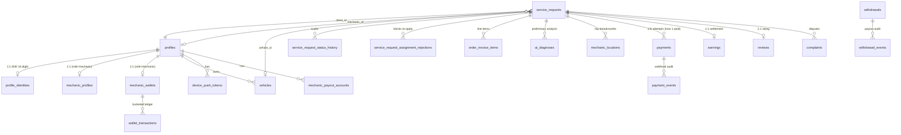

# Database Schema, Views, RPC & Matriks RLS

Dokumen ini menjelaskan struktur tabel, view, fungsi RPC, kebijakan Row Level Security (RLS), serta aturan Storage di **MontirGo**.

---

## 1. Entity Relationship Ringkas

---

## 2. Tabel Inti & Perubahan Standar

- **Identitas & Profil**:
  - `profiles`: `id`, `role` (`app_role`: `client | mechanic | admin`), `full_name`, `email`, `phone_number`, `avatar_url`. *(Kolom `identity_number` dihapus agar tidak bocor lewat query profil lawan transaksi).*
  - `profile_identities`: `profile_id` (PK), `identity_number` (16 digit unik, permanen untuk user).
  - `mechanic_profiles`: profil bengkel, `skills`, `vehicle_specialization`, `certifications`, `workshop_photos[]`, `service_radius_km`, `is_online`, `is_available`, `is_verified`, `rating_avg`, `rating_count`, `total_jobs`, `current_lat`, `current_lng`, `location` (`geography(Point, 4326)`).
- **Order & Operasional**:
  - `vehicles`: data kendaraan client + `photo_url` (path privat).
  - `service_requests`: order layanan + `location` (`geography(Point, 4326)`), `route_polyline`, `route_distance_m`, `route_duration_s`, `route_updated_at`, `price_amount` (`bigint`).
  - `order_invoice_items`: rincian tagihan (`description text`, `amount bigint`).
  - `service_request_status_history`, `service_request_assignment_rejections`, `mechanic_locations`, `activity_logs`, `notifications`, `device_push_tokens`, `reviews`, `complaints`.
- **AI**:
  - `ai_diagnoses`: khusus hasil JSON analisis awal `analyze-request` (tidak pernah dicampur dengan chat bebas).
  - `ai_chat_messages`: riwayat percakapan `ai-assistant` per user/order/mode.
  - `ai_usage_logs`: pencatatan rate limit per jam per user per endpoint.
- **Finansial**:
  - `platform_settings`: parameter bisnis (`fee_percent`, `hold_days`, `min_withdrawal`, `min_order_price`, `max_order_price`, `max_cash_commission_debt`, `default_match_radius_km`, `request_expire_minutes`).
  - `payments`: relasi 1-to-many ke `service_requests` dengan `attempt_no`, `cancelled_at`, partial unique `payments_one_paid_per_request`, dan partial unique `payments_one_pending_per_request`.
  - `payment_events`, `earnings`, `mechanic_payout_accounts`, `mechanic_wallets` (termasuk `commission_debt`), `withdrawals`, `withdrawal_events`, `wallet_transactions` (ber-bucket & bertanda `+`/`-`).

---

## 3. Matriks RLS & Proteksi Kolom

| Tabel | Client | Mechanic | Admin | Service Role | Catatan Penting |
| --- | --- | --- | --- | --- | --- |
| `profiles` | SELECT own & counterpart; INSERT `role='client'`; UPDATE own (role immutable) | Sama | ALL | ALL | Tanpa NIK; admin ubah role via `set_user_role`. |
| `profile_identities` | SELECT own; INSERT once via RPC `set_my_identity_number` | Sama | ALL | ALL | Trigger menolak UPDATE oleh non-admin. |
| `mechanic_profiles` | *(Tidak ada SELECT langsung)* | SELECT/INSERT/UPDATE own | ALL | ALL | Client baca via `mechanic_directory` / `list_nearby_mechanics`. Trigger `protect_mechanic_profile_columns()` melarang non-admin mengubah `is_verified`, `rating_*`, `total_jobs`, `is_available`, dan melarang `is_online=true` jika `is_verified=false`. Trigger `refresh_mechanic_rating()` & `refresh_mechanic_jobs()` (`SECURITY DEFINER`, `EXECUTE` khusus `service_role`) menyetel & memulihkan `app.internal_rpc = '1'` per transaksi; `finalize_payment` / `confirm_cash_payment` tidak meng-increment `total_jobs` secara manual agar tidak terjadi double-count. |
| `reviews` | SELECT public; INSERT own (hanya order `paid`) | SELECT own | ALL | ALL | Trigger `trg_reviews_refresh_rating` otomatis memperbarui `rating_avg` & `rating_count` di `mechanic_profiles`. |
| `service_requests` | SELECT own | SELECT assigned | ALL | ALL | **Tidak ada INSERT/UPDATE/DELETE langsung dari SDK.** Semua mutasi via RPC. |
| `order_invoice_items` | SELECT saat status `payment`/`paid` | SELECT assigned; INSERT/UPDATE/DELETE saat `status='arrived'` | ALL | ALL | Montir harus `reopen_order_invoice` dulu untuk mengedit ulang saat `payment`. |
| `complaints` | SELECT & INSERT own (untuk order miliknya) | Sama | ALL | ALL | Trigger `complaints_prepare_insert` memvalidasi partisipan & memaksa `status='open'`; trigger `complaints_prepare_update` mengisi `resolved_by`/`resolved_at`. |
| `payments`, `earnings`, `mechanic_wallets`, `withdrawals`, `wallet_transactions` | SELECT partisipan (`payments`) | SELECT own | ALL | ALL | Seluruh mutasi **hanya** lewat `service_role` / RPC `SECURITY DEFINER`. |
| `ai_diagnoses` | SELECT partisipan | SELECT partisipan + verified mechanic di open request | ALL | ALL | INSERT/UPDATE hanya via Edge Function (`service_role`). |
| `ai_chat_messages`, `device_push_tokens` | ALL own | ALL own | ALL | ALL | Terisolasi per `auth.uid()`. |

---

## 4. Kebijakan Storage Buckets

| Bucket | Visibilitas | Aturan Akses |
| --- | --- | --- |
| `avatars` | Public | Read untuk authenticated; upload di folder `<auth.uid()>/...`. |
| `vehicle-photos` | Private (Signed URL) | Pemilik, montir yang ditugaskan, **montir terverifikasi** saat request terbuka (`status='requested'`), atau admin. |
| `workshop-photos` | Private (Signed URL) | Pemilik, admin, client yang punya order dengan montir tsb, atau authenticated user khusus foto sampul (`workshop_photos[1]`) dari montir `is_online=true AND is_verified=true`. |
| `complaint-photos` | Private (Signed URL) | Pelapor (`folder[1] = auth.uid()`) dapat read/insert/delete; admin dapat read/manage semua. |
