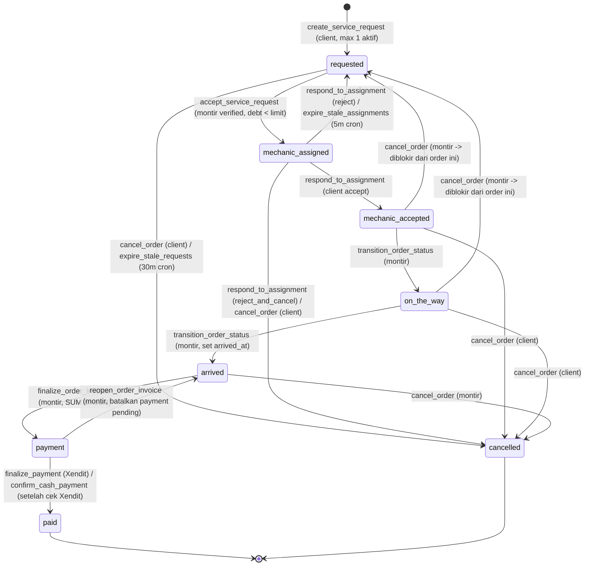

# Order State Machine & Aturan Alur Kerja

Dokumen ini mendefinisikan **8 status resmi** `public.service_requests.status` serta aturan transisi atomik yang dikunci di PostgreSQL.

---

## 1. Diagram Status Resmi

> Status legacy (`matching`, `diagnosing`, `repairing`, `completed`) dipensiunkan. `completed_at` diisi otomatis saat order mencapai `paid`.

---

## 2. Matriks Transisi

| Dari Status | Ke Status | Aktor | RPC / Mekanisme | Syarat & Efek Samping |
| --- | --- | --- | --- | --- |
| *(baru)* | `requested` | `client` | `create_service_request` | Client belum punya order aktif (`sr_one_active_per_client`), validasi keluhan & no HP, tulis history/activity, kirim notifikasi ke montir online & verified dalam radius PostGIS. |
| `requested` | `mechanic_assigned` | `mechanic` | `accept_service_request` | `is_verified = true`, `commission_debt < max_cash_commission_debt`, tidak ada order aktif (`sr_one_active_per_mechanic`), tidak pernah ditolak di order ini. Set `assignment_expires_at = now() + 5 menit`, set `is_available = false`, notif client. |
| `requested` | `cancelled` | `client` / `pg_cron` | `cancel_order` / `expire_stale_requests` | Client batal manual, atau request > 30 menit belum ada montir. Notif client jika auto-expire. |
| `mechanic_assigned` | `mechanic_accepted` | `client` | `respond_to_assignment('accept')` | Belum kedaluwarsa (`assignment_expires_at > now()`). Set `accepted_at = now()`, `assignment_expires_at = null`, notif montir. Mulai titik ini `contact_phone` & koordinat client terbuka ke montir. |
| `mechanic_assigned` | `requested` | `client` / `pg_cron` | `respond_to_assignment('reject')` / `expire_stale_assignments` | Catat montir ke `service_request_assignment_rejections` (jika reject manual), set `mechanic_id = null`, `is_available = true`, notif montir, tawari ulang ke montir terdekat lain. |
| `mechanic_assigned` | `cancelled` | `client` | `respond_to_assignment('reject_and_cancel')` / `cancel_order` | Set `mechanic_id = null`, `is_available = true`, notif montir. |
| `mechanic_accepted` | `on_the_way` | `mechanic` | `transition_order_status('on_the_way')` | Notif client bahwa montir berangkat; tracking GPS background aktif. |
| `on_the_way` | `arrived` | `mechanic` | `transition_order_status('arrived')` | Set `arrived_at = now()`, hentikan tracking background, notif client. |
| `mechanic_accepted`, `on_the_way` | `requested` | `mechanic` | `cancel_order` | Montir batal sebelum tiba → order **dibuka kembali untuk montir lain** (`requested`), montir masuk `service_request_assignment_rejections`, `is_available = true`, notif client + notif montir lain. |
| `mechanic_accepted`, `on_the_way` | `cancelled` | `client` | `cancel_order` | Client batal sebelum montir tiba → `cancelled`, `is_available = true`, notif montir. |
| `arrived` | `cancelled` | `mechanic` | `cancel_order` | Montir batal setelah tiba (dengan alasan) → `cancelled`, `is_available = true`, notif client. |
| `arrived` | `payment` | `mechanic` | `finalize_order_invoice` | Minimal 1 baris `order_invoice_items`, total `SUM(amount)` dalam rentang `[min_order_price, max_order_price]`. Set `price_amount`, `payment_method = null`, notif client. |
| `payment` | `arrived` | `mechanic` | `reopen_order_invoice` | Hanya jika belum ada `payments` berstatus `paid`. Batalkan semua `payments` berstatus `pending`, kosongkan `price_amount` & `payment_method`, notif client bahwa montir merevisi tagihan. |
| `payment` | `paid` | `service_role` | `finalize_payment` / `confirm_cash_payment` | Set `completed_at = now()`, `is_available = true`, catat `earnings` & ledger dompet, notif kedua pihak; trigger `trg_service_requests_refresh_jobs` memperbarui `total_jobs`, dan ulasan client setelah `paid` memperbarui `rating_avg`/`rating_count` via `trg_reviews_refresh_rating`. |

---

## 3. Aturan Invariant Tambahan

1. **Satu Order Aktif per Pihak**:
   - Partial unique index `sr_one_active_per_client` dan `sr_one_active_per_mechanic` menjamin di level DB tidak ada duplikasi order aktif (`status NOT IN ('paid', 'cancelled')`).
2. **Penjadwalan Otomatis (`pg_cron`)**:
   - `montirgo-expire-assignments`: setiap 1 menit mengembalikan `mechanic_assigned` yang melewati `assignment_expires_at` (5 menit) ke `requested`.
   - `montirgo-expire-requests`: setiap 1 menit membatalkan `requested` yang melewati `request_expire_minutes` (default 30 menit).
