# Order State Machine & Aturan Alur Kerja

Dokumen ini mendefinisikan **8 status resmi** `public.service_requests.status` serta sub-status **Digital Approval** (`quote_status`) di dalam `arrived` yang dikunci di PostgreSQL.

---

## 1. Diagram Status Resmi (8 Status Utuh)

```mermaid
stateDiagram-v2
    [*] --> requested: create_service_request (snapshot callout_fee_tier & amount)
    requested --> mechanic_assigned: accept_service_request (montir verified, debt < limit)
    requested --> cancelled: cancel_order (client) / expire_stale_requests (30m cron)

    mechanic_assigned --> mechanic_accepted: respond_to_assignment (client accept)
    mechanic_assigned --> requested: respond_to_assignment (reject) / expire_stale_assignments (5m cron)
    mechanic_assigned --> cancelled: respond_to_assignment (reject_and_cancel) / cancel_order (client)

    mechanic_accepted --> on_the_way: transition_order_status (montir)
    mechanic_accepted --> requested: cancel_order (montir -> diblokir dari order ini)
    mechanic_accepted --> cancelled: cancel_order (client)

    on_the_way --> arrived: transition_order_status (montir, set arrived_at, seed callout_fee)
    on_the_way --> requested: cancel_order (montir -> diblokir dari order ini)
    on_the_way --> cancelled: cancel_order (client)

    arrived --> payment: finalize_order_invoice (montir, wajib quote_status = approved) OR respond_to_quote('callout_only')
    arrived --> cancelled: cancel_order (montir, wajib alasan; diizinkan setelah quote_expires_at jika pending)

    payment --> arrived: reopen_order_invoice (montir -> reset quote_status = draft, dilarang bila callout_only)
    payment --> paid: finalize_payment (Xendit) / confirm_cash_payment (setelah cek Xendit)
    paid --> [*]
    cancelled --> [*]
```

> Status legacy (`matching`, `diagnosing`, `repairing`, `completed`) dipensiunkan. `completed_at` diisi otomatis saat order mencapai `paid`. Kontrak 8 status resmi tidak diubah demi kompatibilitas penuh dengan `montirgo-admin` dan versi aplikasi lama.

---

## 2. Sub-Status Digital Approval di Dalam `arrived` (`quote_status`)

Saat montir tiba di lokasi (`status = 'arrived'`), sistem otomatis membuat baris `order_invoice_items` bertipe `callout_fee` (`is_locked = true`) sesuai `callout_fee_amount` yang di-snapshot ketika order dibuat. Sebelum menagih (`payment`), estimasi perbaikan melewati siklus `quote_status`:

| Dari `quote_status` | Ke `quote_status` | Aktor | RPC | Efek & Aturan |
| --- | --- | --- | --- | --- |
| `draft` | `pending_approval` | `mechanic` | `submit_order_quote(p_request_id, p_photo_paths)` | Memastikan baris `callout_fee` ada, memvalidasi total `SUM(amount)` aktif (`voided_at is null`), menyimpan maks 3 path foto `quote-photos` opsional, dan menyetel `quote_expires_at = now() + 15 menit`. |
| `pending_approval` | `draft` | `mechanic` | `withdraw_order_quote(p_request_id)` | Menarik estimasi yang belum dijawab client agar montir dapat mengubah rincian item. |
| `pending_approval` | `draft` | `client` | `respond_to_quote(p_request_id, 'request_revision', p_note)` | Client meminta revisi estimasi beserta catatan opsional; montir mengedit item dan mengirim ulang. |
| `pending_approval` | `approved` | `client` | `respond_to_quote(p_request_id, 'approve')` | Menandai seluruh item aktif `approved_at = now()` sehingga montir dapat bekerja lalu memanggil `finalize_order_invoice`. |
| `approved` | `pending_approval` | `mechanic` | `request_quote_addon(p_request_id, p_description, p_amount, p_item_type, p_photo_paths)` | Menambah item temuan baru di tengah pengerjaan (`approved_at = null`) dan meminta persetujuan ulang client. |
| `pending_approval` | `callout_only` (+ `status = 'payment'`) | `client` | `respond_to_quote(p_request_id, 'callout_only', p_note)` | Client menolak perbaikan dan memilih bayar **Biaya Panggil Saja**. Item non-`callout_fee` di-soft-void (`voided_at = now()`), snapshot bukti penolakan disimpan ke `rejected_quote_snapshot`, dan order langsung dikunci ke `payment` dengan nominal `callout_fee_amount`. |

---

## 3. Matriks Transisi Status Utama

| Dari Status | Ke Status | Aktor | RPC / Mekanisme | Syarat & Efek Samping |
| --- | --- | --- | --- | --- |
| *(baru)* | `requested` | `client` | `create_service_request` | Client belum punya order aktif (`sr_one_active_per_client`), validasi keluhan & no HP, snapshot `callout_fee_tier` (`motor \| mobil \| derek`) & `callout_fee_amount` di server, tulis history/activity, notif montir online & verified dalam radius PostGIS. |
| `requested` | `mechanic_assigned` | `mechanic` | `accept_service_request` | `is_verified = true`, `commission_debt < max_cash_commission_debt`, tidak ada order aktif (`sr_one_active_per_mechanic`), tidak pernah ditolak di order ini. Set `assignment_expires_at = now() + 5 menit`, set `is_available = false`, notif client. |
| `requested` | `cancelled` | `client` / `pg_cron` | `cancel_order` / `expire_stale_requests` | Client batal manual, atau request > 30 menit belum ada montir. Notif client jika auto-expire. |
| `mechanic_assigned` | `mechanic_accepted` | `client` | `respond_to_assignment('accept')` | Belum kedaluwarsa (`assignment_expires_at > now()`). Set `accepted_at = now()`, `assignment_expires_at = null`, notif montir. Mulai titik ini `contact_phone`, koordinat client, dan `vehicle_label`/`vehicle_plate` montir terbuka pasca-penugasan. |
| `mechanic_assigned` | `requested` | `client` / `pg_cron` | `respond_to_assignment('reject')` / `expire_stale_assignments` | Catat montir ke `service_request_assignment_rejections` (jika reject manual), set `mechanic_id = null`, `is_available = true`, notif montir, tawari ulang ke montir terdekat lain. |
| `mechanic_assigned` | `cancelled` | `client` | `respond_to_assignment('reject_and_cancel')` / `cancel_order` | Set `mechanic_id = null`, `is_available = true`, notif montir. |
| `mechanic_accepted` | `on_the_way` | `mechanic` | `transition_order_status('on_the_way')` | Notif client bahwa montir berangkat; tracking GPS background aktif. |
| `on_the_way` | `arrived` | `mechanic` | `transition_order_status('arrived')` | Set `arrived_at = now()`, `quote_status = 'draft'`, seed baris `callout_fee` terkunci, hentikan tracking background, notif client. |
| `mechanic_accepted`, `on_the_way` | `requested` | `mechanic` | `cancel_order` | Montir batal sebelum tiba → order **dibuka kembali untuk montir lain** (`requested`), montir masuk `service_request_assignment_rejections`, `is_available = true`, notif client + notif montir lain. |
| `mechanic_accepted`, `on_the_way` | `cancelled` | `client` | `cancel_order` | Client batal sebelum montir tiba → `cancelled`, `is_available = true`, notif montir. |
| `arrived` | `cancelled` | `mechanic` | `cancel_order` | Wajib menyertakan alasan (`CANCEL_REASON_REQUIRED`). Jika `quote_status = 'pending_approval'`, hanya diizinkan setelah melewati `quote_expires_at` (`QUOTE_APPROVAL_PENDING`) atau setelah `withdraw_order_quote`. Mengembalikan `is_available = true`. |
| `arrived` | `payment` | `mechanic` | `finalize_order_invoice` | Wajib `quote_status in ('approved', 'callout_only')` dan semua item aktif ber-`approved_at`. Total `SUM(amount)` item aktif dalam `[min_order_price, max_order_price]`. Set `price_amount`, `payment_method = null`, notif client. |
| `payment` | `arrived` | `mechanic` | `reopen_order_invoice` | Ditolak bila `quote_status = 'callout_only'` (`CALLOUT_ONLY_LOCKED`) atau sudah ada `payments.status = 'paid'`. Membatalkan `payments` `pending`, mereset `quote_status = 'draft'` serta `approved_at = null` pada item non-callout agar wajib persetujuan ulang client. |
| `payment` | `paid` | `service_role` | `finalize_payment` / `confirm_cash_payment` | Set `completed_at = now()`, `is_available = true`, catat `earnings` & ledger dompet, notif kedua pihak; trigger `trg_service_requests_refresh_jobs` memperbarui `total_jobs` (mengecualikan `quote_status = 'callout_only'`), dan ulasan client setelah `paid` memperbarui `rating_avg`/`rating_count` via `trg_reviews_refresh_rating`. |

---

## 4. Aturan Invariant Tambahan

1. **Satu Order Aktif per Pihak**:
   - Partial unique index `sr_one_active_per_client` dan `sr_one_active_per_mechanic` menjamin di level DB tidak ada duplikasi order aktif (`status NOT IN ('paid', 'cancelled')`).
2. **Penjadwalan Otomatis (`pg_cron`)**:
   - `montirgo-expire-assignments`: setiap 1 menit mengembalikan `mechanic_assigned` yang melewati `assignment_expires_at` (5 menit) ke `requested`.
   - `montirgo-expire-requests`: setiap 1 menit membatalkan `requested` yang melewati `request_expire_minutes` (default 30 menit).
